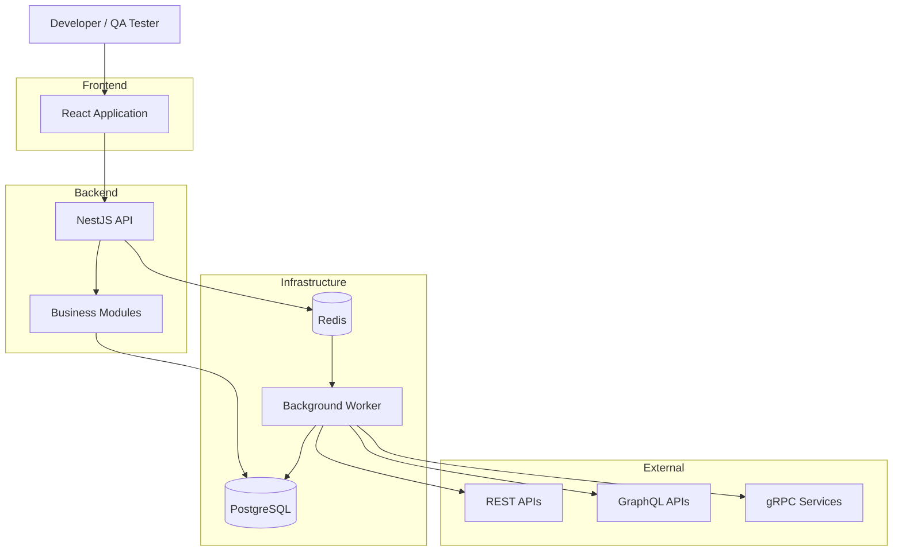

# API Sentinel — System Overview

## 1. Purpose

This document describes the high-level architecture of API Sentinel, including its main components, responsibilities, and communication flow.

## 2. Architectural Approach

API Sentinel will initially use a modular monolith architecture with a separate background worker process.

The system will follow principles from:

- Domain-Driven Design (DDD)
- Hexagonal Architecture
- Clean Architecture

The architecture will prioritize modularity, maintainability, testability, and independent execution of background jobs.

## 3. High-Level Architecture

## 4. Component Responsibilities

### 4.1 Frontend

Technology: React, TypeScript and Vite.

Responsibilities:

- Authentication and user management interfaces.
- Workspace and project management.
- API registration and configuration.
- Test case creation and management.
- Test execution monitoring.
- Execution history and reporting.
- Regression visualization.

### 4.2 Backend API

Technology: NestJS and TypeScript.

Responsibilities:

- Authentication and authorization.
- Workspace and project management.
- API and environment configuration.
- Test case management.
- Execution job creation.
- Execution history and reporting.
- Scheduling and regression management.

### 4.3 Database

Technology: PostgreSQL with Prisma.

Responsibilities:

- Persistent application data.
- User and workspace information.
- Project and API configurations.
- Test cases and assertions.
- Execution history and results.
- Baseline and regression information.

### 4.4 Redis

Responsibilities:

- Background job queue infrastructure.
- Execution coordination.
- Caching where appropriate.

BullMQ will use Redis to manage background execution jobs.

### 4.5 Background Worker

Technology: NestJS, TypeScript and BullMQ.

Responsibilities:

- Consume queued execution jobs.
- Load test configurations.
- Select the appropriate protocol adapter.
- Execute API requests.
- Evaluate assertions.
- Persist execution results.
- Trigger regression comparisons.

### 4.6 Protocol Adapters

The test engine will support protocol-specific adapters:

- REST adapter.
- GraphQL adapter.
- gRPC adapter.

Each adapter will handle the communication requirements of its respective protocol.

## 5. Test Execution Workflow

1. A user creates a test case through the frontend.
2. The NestJS API validates and stores the configuration.
3. The user requests test execution.
4. The API creates an execution record and queues a job.
5. The worker receives the job.
6. The worker loads the test configuration.
7. The appropriate protocol adapter executes the request.
8. The test engine evaluates the assertions.
9. Execution results are stored in PostgreSQL.
10. Regression detection compares results against an approved baseline.
11. The frontend retrieves and displays the execution results.

## 6. Important Architectural Principles

- Business rules should not depend on NestJS, Prisma or Redis.
- Protocol-specific execution logic should be isolated behind adapters.
- Background execution should be independent of HTTP request processing.
- Database access should be isolated behind appropriate persistence abstractions.
- Credentials and sensitive execution evidence must be protected.
- Requests to external API targets must be protected against SSRF.
- The core platform must operate without AI integration.

## 7. Current Architecture Status

This is the initial proposed architecture.

Detailed module boundaries, domain models, database design, security controls and deployment architecture will be documented separately as the project evolves.
